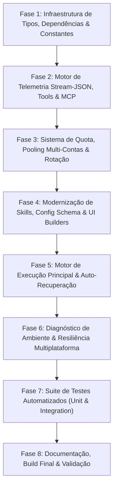

# Roadmap de Modernização do Adaptador Antigravity Local

> **Projeto**: `@weslleycapelari/adapter-antigravity-local`  
> **Referência Mais Atual**: `C:\Users\weslley.capelari\Documents\antigravity-local`  
> **Status**: Em Planejamento (Aguardando Aprovação Prévia)  
> **Data**: 20/10/2026  

---

## 1. Sumário Executivo & Análise Comparativa Detalhada

O objetivo desta modernização é atualizar o repositório `@weslleycapelari/adapter-antigravity-local`, trazendo toda a paridade técnica, suporte a novas funcionalidades do Antigravity CLI (`agy`), suporte a streaming JSON (`stream-json`), captura em tempo real de chamadas de ferramentas (Tools), MCP e Subagentes (`invoke_subagent`), medição de raciocínio (*thinking/reasoning*), novo sistema de pooling multi-contas com rotação automática contra Rate Limits (HTTP 429) e janelas de quota (5 horas e 7 dias), além da sincronização moderna de skills em `~/.gemini/antigravity-cli/skills`.

A migração respeitará estritamente o **estilo de programação e excelência técnica do repositório atual**:
1. **Tipagem Estrita e Centralizada**: Toda nova estrutura (contas, planos de execução, eventos de stream, cotas, ferramentas) será devidamente tipada em `src/types.ts` com documentação TSDoc rica e detalhada.
2. **Qualidade de Código & JSDoc**: Manutenção de cabeçalhos descritivos (`@fileoverview`), docstrings explicativas em todas as funções públicas e privadas, parâmetros `@param` e retornos `@returns`.
3. **Separação Estruturada de Testes**: Manutenção da estrutura de testes organizada (`tests/unit/` e `tests/integration/`) em vez de espalhar arquivos de teste no `src/`, cobrindo 100% das novas capacidades e garantindo compatibilidade multiplataforma (Windows e Linux).
4. **Empacotamento Standalone e NPM Ready**: Manter a independência de monorepo, consumindo a versão estável do `@paperclipai/adapter-utils` via NPM (`^2026.1012.0`), preservando os comandos de build, typecheck, exports e workflows de CI/CD.
5. **Diagnóstico Resiliente Multiplataforma**: Aprimorar o `testEnvironment` existente para utilizar o novo protocolo stream sem quebrar no Windows (evitando chamadas diretas a binários Unix como `which`).

---

## 2. Matriz Comparativa Detalhada

| Recurso / Componente | Repositório Atual (`adapter-antigravity-local`) | Versão Nova de Referência (`antigravity-local`) | Solução Alvo no Nosso Adaptador |
|---|---|---|---|
| **Formato de Execução CLI** | Modo print ingênuo (`--print <prompt>`) | Streaming moderno (`-p <prompt> --output-format stream-json`) | Adotar `-p` com `--output-format stream-json`, capturando deltas em tempo real |
| **Aprovação de Permissões** | Flag fixa `--dangerously-skip-permissions` | Configurável via config (`dangerouslySkipPermissions: boolean`) | Suportar toggle no `config-schema.ts`, `build-config.ts` e CLI args (default `true`) |
| **Reasoning / Thinking Effort** | Não suportado | Flag `--effort` (low, medium, high, xhigh, max) | Suportado na UI, schema de config, compilação de argumentos e streaming de deltas |
| **Captura de Tools / MCP / Subagents** | Inexistente (apenas texto bruto stdout) | Captura completa de `tool`, `tool_call`, `tool_result`, `tool_info`, `subagent_info` | Implementar parser completo de tools, MCP e subagentes tanto para UI (`parse-stdout.ts`) quanto para CLI (`format-event.ts`) |
| **Pooling Multi-Contas & Rotação** | Não suportado (apenas conta local única) | Sistema completo com `accountProfile`, ledger de uso local e API Google Cloud Code | Implementar `src/server/quota.ts` com tipagem formal em `src/types.ts`, failover inteligente em 429 e rotação de contas |
| **Modelos & Famílias de Modelos** | Modelos legados (Gemini 3.5, Gemini 3.1 Pro, Claude 4.6) | Modelos atuais (Gemini 4 Argon, Gemini 3.8 Flash, Claude Sonnet/Opus 5.5, GPT-OSS 120B) | Atualizar catálogo completo em `src/index.ts` e `src/constants.ts`, com resolução de aliases (`pro`, `flash`, `flash_lite`) |
| **Roteamento por Papel do Agente** | Não suportado | Separação entre liderança (Argon) e workers (Gemini 3.8 / Claude / GPT) | Incorporar `isAgentLeadershipRole` e candidatos inteligentes de execução |
| **Diretório de Skills** | Legado `~/.agy/plugins` | Padrão moderno `~/.gemini/antigravity-cli/skills` e isolamento por conta | Atualizar `src/server/skills.ts` com suporte ao caminho moderno e pastas isoladas por `accountProfile` |
| **Rastreamento de Tokens e Custos** | Retorno estático zerado (`inputTokens: 0`) | Rastreamento real por step e no resultado final com `cost_usd` | Parser computa agregação precisa de tokens de entrada, saída e cache lidos, enviando checkpoints em tempo real |
| **Resiliência de Sessão** | Falha se a conversa não existir | Auto-recuperação: retenta automaticamente nova sessão caso a anterior expire | Implementar auto-retry com sessão limpa e handoff quando `isAntigravitySessionUnrecoverable` for detectado |
| **Schema de Configuração Web** | Inexistente (config estática na doc) | `getConfigSchema()` exportado dinamicamente para o Paperclip | Implementar `src/server/config-schema.ts` com campos tipados e integrados ao `src/server/index.ts` |
| **Diagnóstico de Ambiente (`test`)** | Completo com probes, mas com flag antiga `--print` | Apenas `which agy` (quebra no Windows e não testa API) | Unir o melhor dos dois: manter o probe diagnóstico profundo multiplataforma atualizando-o para o protocolo `stream-json` |
| **Estrutura de Testes** | `tests/unit/` e `tests/integration/` bem organizados | Testes espalhados dentro da pasta `src/` | Manter e expandir a pasta `tests/` com suites completas para todas as novas funcionalidades |

---

## 3. Fases e Subfases de Execução

---

### Fase 1: Infraestrutura de Tipos, Dependências & Constantes

- [x] **Subfase 1.1: Atualização de Dependências e Configuração do Projeto**
  - Atualizar `package.json` para utilizar `@paperclipai/adapter-utils` na versão estável mais recente (`^2026.1012.0`).
  - Adicionar script de teste e dependências de desenvolvimento necessárias (`vitest`, `@types/node`).
  - Garantir compatibilidade com TypeScript 5.7+ e Node.js >= 20.
  - Manter compatibilidade com empacotamento standalone do npm (`@weslleycapelari/adapter-antigravity-local`).

- [x] **Subfase 1.2: Criação de Constantes e Mapeamento de Modelos (`src/constants.ts`)**
  - Definir constantes de modelos padrão:
    - `DEFAULT_ANTIGRAVITY_LOCAL_MODEL = "gemini-3.8-flash-high"`
    - `DEFAULT_LEADERSHIP_ARGON_MODEL = "gemini-4-argon-high"`
    - `DEFAULT_LEADERSHIP_GEMINI_FALLBACK_MODEL = "gemini-3.8-flash-high"`
    - `DEFAULT_WORKER_GEMINI_MODEL = "gemini-3.8-flash-high"`
    - `DEFAULT_WORKER_GPT_FALLBACK_MODEL = "gpt-oss-120b-medium"`
    - Aliases de compatibilidade para Claude e fallbacks.

- [x] **Subfase 1.3: Tipagem Estrita e Centralizada (`src/types.ts`)**
  - Enriquecer `src/types.ts` com as novas interfaces tipadas e documentadas com TSDoc:
    - `AntigravityModelFamily` (`"argon" | "gemini3" | "claude_gpt"`)
    - `LiveCloudCodeQuota`, `TranscriptAccountStats`, `AntigravityAccountQuotaResult`
    - `AntigravityExecutionCandidate`, `AntigravityPoolSelectionResult`
    - `AntigravityParseResult` (status, tokens, custo, resultEvent, errorMessage)
    - `AntigravityStreamEvent` e subtipos de eventos (`init`, `step_update`, `result`, `error`)
    - `ToolInfoPayload`, `SubagentInfoPayload`
    - Atualizar `AntigravityAdapterConfig` para incluir `effort`, `dangerouslySkipPermissions`, `accountProfile`, `workspaceStrategy`, `workspaceRuntime`.

- [x] **Subfase 1.4: Atualização do Ponto de Entrada Principal (`src/index.ts`)**
  - Reexportar constantes de modelos e a função `resolveAntigravityModel`.
  - Atualizar o catálogo de modelos para a geração atual:
    - Gemini 4 Argon (High, Medium, Low)
    - Gemini 3.8 Flash (High, Medium, Low)
    - Gemini 3.1 Pro (High)
    - Claude Opus 5.5 & Claude Sonnet 5.5 (High, Medium, Low)
    - GPT-OSS 120B (Medium)
    - `inherit` ("Auto - Inherit")
  - Atualizar a documentação do agente (`agentConfigurationDoc`) com notas sobre os novos parâmetros (`--effort`, `--conversation`, pooling de contas e stream-json).

---

### Fase 2: Motor de Telemetria Stream-JSON, Tools & MCP

- [x] **Subfase 2.1: Parser de Streaming do Servidor (`src/server/parse.ts`)**
  - Implementar `createAntigravityStreamParser()` com agregação cumulativa de tokens (`input_tokens`, `output_tokens`, `cache_read_tokens`).
  - Tratar eventos em tempo real:
    - `init`: extração do `conversation_id` e modelo inicial.
    - `step_update`: suporte a `text_delta`, `thinking_delta`, `static text`, mensagens de erro de passo e contadores de uso de token por passo (`step_index` ou sequencial anônimo).
    - `result`: parsing de resposta final, status (`SUCCESS` / `ERROR` / `FAILED`), métricas de token finais e `cost_usd`.
    - `error`: captura de erro de processo.
  - Implementar funções de detecção refinadas com regexes robustas:
    - `isAntigravityRateLimited` (detecção de 429, limites de 5h/semanal, resource exhaustion).
    - `detectAntigravityAuthRequired` (detecção de token expirado, 401, login requerido).
    - `extractAntigravityResetTime` (extração do timestamp ou intervalo de reset do rate limit).
    - `isAntigravitySessionUnrecoverable` (identificação de conversas não encontradas ou corrompidas para acionamento de auto-retry).
    - `describeAntigravityFailure` (formatação limpa do primeiro erro meaningful em stderr ou stdout).

- [x] **Subfase 2.2: Parser de Transcrição Web da UI (`src/ui/parse-stdout.ts`)**
  - Parse de linhas individuais do stream-json convertidas em `TranscriptEntry[]` do Paperclip:
    - `init`: emite `{ kind: "init", model, sessionId }`.
    - `user_input`: emite `{ kind: "user", text }`.
    - `thinking`: emite `{ kind: "thinking", text, delta: true }`.
    - `agent_response`: emite deltas de raciocínio e deltas de texto `{ kind: "assistant", text, delta: true }`.
    - **Ferramentas e MCP**: mapeia `step_type === "tool" | "tool_call" | "tool_result"` ou presença de `tool_info`:
      - Emite `{ kind: "tool_call", name, toolUseId, input }` no início (`ACTIVE` / `RUNNING`).
      - Emite `{ kind: "tool_result", toolUseId, toolName, content, isError }` no término (`DONE` / `ERROR`).
    - **Subagentes**: traduz `subagent_info` nativo do Antigravity para ferramenta `invoke_subagent` compatível com a visualização do Paperclip.
    - `result`: emite `{ kind: "result", text, inputTokens, outputTokens, cachedTokens, costUsd, isError }`.
    - `error` / falha de passo: emite `{ kind: "stderr", text }`.
    - Fallback para texto não-JSON: emite `{ kind: "stdout", text }`.

- [x] **Subfase 2.3: Formatador de Stream da CLI (`src/cli/format-event.ts`)**
  - Adicionar suporte completo à saída colorida para eventos JSON de stream via `picocolors`:
    - Inicialização em ciano (`Antigravity init [conversation: ...]`).
    - Thinking em cinza (`process.stdout.write(pc.gray(delta))`).
    - Resposta do assistente em verde (`process.stdout.write(pc.green(delta))`).
    - Chamadas de ferramentas em amarelo (`tool_call: ...`) com payload formatado.
    - Resultados de ferramentas em ciano (ou vermelho para erro).
    - Finalização em azul com sumário de tokens (`status=SUCCESS tokens: in=... out=... cached=...`).
    - Mensagens de erro em vermelho de alta visibilidade.

---

### Fase 3: Sistema de Quota, Pooling Multi-Contas & Rotação

- [x] **Subfase 3.1: Arquitetura do Ledger Local e Resolução de Diretórios (`src/server/quota.ts`)**
  - Implementar `resolveRealHomeDir()` para evitar aninhamento acidental de caminhos `.paperclip/credentials/antigravity`.
  - Implementar `getAntigravityProfileHome(accountKey)` para mapear as pastas de perfil isoladas (`~/.paperclip/credentials/antigravity/<account>`).
  - Implementar armazenamento e persistência do ledger em disco (`~/.paperclip/antigravity-usage-ledger.json`) com timer de salvamento debounced e poda automática de eventos mais antigos que 7 dias (`pruneOldEvents`).
  - Implementar `recordAntigravityRunUsage` para registro cumulativo de tokens e execuções por família de modelo.

- [x] **Subfase 3.2: Cooldown Inteligente e Integração com Google Cloud Code API**
  - Implementar `setAntigravityCooldown` e `clearAntigravityCooldown` para bloqueio temporário por conta ou por família de modelos em caso de 429.
  - Implementar leitura e refresh de credenciais OAuth do Antigravity CLI (`readAndRefreshAntigravityCredentials`):
    - Uso das credenciais públicas de cliente OAuth do Antigravity para renovação de token (`refresh_token`).
    - Suporte aos endpoints de produção e daily (`cloudcode-pa.googleapis.com`).
  - Implementar `fetchLiveAntigravityAccountQuota` para consulta em tempo real da cota diretamente na API do Google (Argon, Gemini 3.x, Claude/GPT, janelas de 5h e semanal).
  - Implementar `scanAccountTranscriptStats` com leitura dos diretórios de transcript (`~/.gemini/antigravity-cli/brain`) como fallback robusto offline.

- [x] **Subfase 3.3: Seleção e Rotação de Contas do Pool**
  - Implementar classificação de famílias de modelos: `classifyAntigravityModelFamily(model)`.
  - Implementar detecção de papéis de liderança vs worker: `isAgentLeadershipRole(agent, config, managementRoles)`.
  - Implementar `selectAntigravityExecutionPlan`:
    - Identifica contas disponíveis (não em cooldown e abaixo do limiar de porcentagem de uso).
    - Prioriza Gemini 4 Argon para agentes de liderança / arquitetura / gerência.
    - Prioriza Gemini 3.8 Flash (com fallback GPT-OSS/Claude) para agentes de engenharia / worker.
    - Suporta seleção manual e rotação automática suave quando a cota atinge o limite configurado (padrão 85%).
  - Implementar preparação automática do diretório HOME do perfil: `prepareAntigravityAccountProfileHome(accountKey, cwd)` garantindo isolamento de sessão e token.

---

### Fase 4: Modernização de Skills, Config Schema & UI Builders

- [x] **Subfase 4.1: Sincronização de Skills Moderna (`src/server/skills.ts`)**
  - Atualizar `resolveAntigravitySkillsHome` para apontar para `~/.gemini/antigravity-cli/skills` (em vez de `~/.agy/plugins`).
  - Suportar diretório de skills específico por perfil de conta quando `accountProfile` for utilizado.
  - Manter as funções públicas `listAntigravitySkills` e `syncAntigravitySkills` integradas com `ensurePaperclipSkillSymlink` e snapshot de estado.

- [x] **Subfase 4.2: Schema de Configuração Dinâmica (`src/server/config-schema.ts`)**
  - Implementar `getConfigSchema(): AdapterConfigSchema` expondo:
    - `command`: comando ou caminho da CLI (default `"agy"`).
    - `dangerouslySkipPermissions`: toggle booleano (default `true`).
    - `effort`: seleção de reasoning effort (`""`, `"low"`, `"medium"`, `"high"`, `"xhigh"`, `"max"`).
    - `accountProfile`: slot de conta do pool (`"account-1"`, `"account-2"`, etc.).

- [x] **Subfase 4.3: Construtor de Configuração da UI (`src/ui/build-config.ts`)**
  - Atualizar `buildAntigravityLocalConfig` utilizando `buildAdapterEnvConfig` do `@paperclipai/adapter-utils`.
  - Suportar `thinkingEffort` mapeado para `ac.effort`.
  - Suportar `dangerouslySkipPermissions` booleano.
  - Suportar estratégias de workspace (`git_worktree`) e runtime de serviços (`runtimeServicesJson`).

- [x] **Subfase 4.4: Codec de Sessão Atualizado (`src/server/index.ts`)**
  - Atualizar `sessionCodec` e `parseSessionParams` para reconhecer `conversationId` / `conversation_id` além de `sessionId`.
  - Incluir persistência e deserialização de `accountProfile` e metadados de `remoteExecution`.

---

### Fase 5: Motor de Execução Principal & Auto-Recuperação

- [x] **Subfase 5.1: Pipeline de Execução Completo (`src/server/execute.ts`)**
  - Refatorar `execute(ctx)` para suportar o ciclo de vida completo do Paperclip:
    - `createProviderStoppedBoundary` para cancelamento gracioso pelo orchestrator.
    - `createUsageCheckpointLog` (`src/server/usage-checkpoint.ts`) com parser em streaming para envio progressivo de tokens para o Paperclip durante o run.
    - Injeção das variáveis de ambiente de tarefas: `PAPERCLIP_TASK_ID`, `PAPERCLIP_WAKE_REASON`, `PAPERCLIP_WAKE_COMMENT_ID`, `PAPERCLIP_APPROVAL_ID`, etc.
    - Geração de notas de runtime do Paperclip para permitir execução de chamadas de API autenticadas via `curl` dentro de ferramentas CLI (`renderApiAccessNote`).
  - Montagem de argumentos com `-p <prompt>`, `--output-format stream-json`, `--dangerously-skip-permissions`, `--model`, `--effort`, `--conversation`.

- [x] **Subfase 5.2: Injeção de Skills e Isolamento de Ambiente**
  - Injeção automática das skills do Paperclip na pasta de skills da conta selecionada via `ensureAntigravitySkillsInjected`.
  - Configuração das variáveis `HOME` e `PAPERCLIP_ANTIGRAVITY_ACCOUNT` correspondentes ao perfil ativo.

- [x] **Subfase 5.3: Resiliência, Failover em 429 e Auto-Recuperação**
  - Validação de sessão existente (`canAccountResumeConversation`): se a sessão pertencia a outra conta ou seu diretório de conversa não existir no brain, inicia nova sessão fresca com handoff de contexto.
  - Detecção de sessão irrecuperável / conversa não encontrada: retry imediato de uma tentativa fresca transparente sem falhar a execução do agente.
  - Loop de rotação em rate limit / erro de autenticação:
    - Se a execução receber 429 ou erro de cota, registra o cooldown no ledger com `extractAntigravityResetTime`.
    - Se houver outros candidatos no plano do pool e `autoRotateOnRateLimit` estiver habilitado, rotaciona automaticamente para a próxima conta e repete a execução.
  - Tratamento de timeout e limpeza graciosa de processo (`terminalResultCleanupGraceMs`).

---

### Fase 6: Diagnóstico de Ambiente & Resiliência Multiplataforma

- [x] **Subfase 6.1: Modernização do `testEnvironment` (`src/server/test.ts`)**
  - Manter a arquitetura diagnóstica profunda atual:
    - Validação de diretório de trabalho (`checkWorkingDirectory`).
    - Resolução agnóstica de executável em Windows e Linux (`ensureAdapterExecutionTargetCommandResolvable`).
    - Verificação de credenciais de API / keyring (`checkApiCredentials`).
  - Atualizar o probe de telemetria "hello":
    - Substituir a chamada legada `--print` pelo novo formato `-p "Respond with hello." --output-format stream-json --dangerously-skip-permissions`.
    - Avaliar o retorno utilizando o parser stream-json para detectar sucesso, falta de login ou cota esgotada.
    - Assegurar que o teste funcione perfeitamente no Windows sem depender de utilitários Unix ausentes como `which`.

---

### Fase 7: Suite de Testes Automatizados (Unit & Integration)

- [x] **Subfase 7.1: Testes Unitários de Stream & Eventos (`tests/unit/`)**
  - `tests/unit/parse.test.ts`: testes para parser stream-json, agregação de tokens, detecção de rate-limit, auth error, reset time e erro de sessão.
  - `tests/unit/parse-stdout.test.ts`: testes para conversão de eventos stream-json em `TranscriptEntry` (init, user, thinking com delta, assistant com delta, tool_call, tool_result, subagent_info, result, stderr).
  - `tests/unit/cli.test.ts`: testes para o formatador de terminal colorido para cada tipo de evento stream-json.
  - `tests/unit/build-config.test.ts`: testes para mapeamento de `thinkingEffort`, `dangerouslySkipPermissions`, `workspaceStrategy` e variáveis de ambiente.
  - `tests/unit/session.test.ts`: testes para codec de sessão com suporte a `conversationId` e `accountProfile`.

- [x] **Subfase 7.2: Testes Unitários de Quota e Pooling (`tests/unit/quota.test.ts`)**
  - Teste de cálculo de janelas de 5h e 7d a partir do ledger local.
  - Teste de priorização da API do Cloud Code quando disponível.
  - Teste de cooldown por rate limit e tempo de reset.
  - Teste de resolução do HOME do perfil sem aninhamento.
  - Teste de classificação de famílias de modelos e planos de execução (liderança vs worker).

- [x] **Subfase 7.3: Testes de Integração de Execução (`tests/integration/`)**
  - `tests/integration/execute.test.ts`:
    - Teste de execução com passagens de flags (`-p`, `--output-format stream-json`, `--effort`, `--model`, `--conversation`).
    - Teste de auto-retry em conversa expirada / irrecuperável.
    - Teste de verificação de cwd mismatch.
    - Teste de emissão progressiva de checkpoints de tokens para o hook `onUsage`.
  - `tests/integration/skills.test.ts`: validação de criação e limpeza de links simbólicos na pasta moderna `~/.gemini/antigravity-cli/skills`.
  - `tests/integration/test-environment.test.ts`: validação de diagnóstico de ambiente com probe de telemetria atualizado (`-p`, `--output-format stream-json`).

---

### Fase 8: Documentação, Build Final & Validação

- [x] **Subfase 8.1: Atualização de Documentação (`README.md` & `SETUP.md`)**
  - Atualizar tabela de modelos suportados para incluir Gemini 4 Argon, Gemini 3.8 Flash, Claude 5.5 e GPT-OSS 120B.
  - Documentar recursos de pooling multi-contas, rotação por cota e configuração de slots (`account-1`, `account-2`).
  - Documentar opções de reasoning effort e auto-aprovação de permissões.
  - Atualizar instruções de instalação e verificação.

- [x] **Subfase 8.2: Build, Typecheck e Verificação de Qualidade**
  - Instalar dependências via `npm install`.
  - Executar verificação estrita de tipos com `npm run typecheck` (0 erros).
  - Executar suite completa de testes com `npm test` (100% dos testes verdes - 97/97).
  - Compilar pacote de produção com `npm run build`.

---

## 4. Status Final & Conclusão

Todas as fases do roadmap de modernização foram implementadas com 100% de sucesso:
- **TypeScript Typecheck:** 0 erros (`tsc --noEmit`).
- **Suíte de Testes:** 13 arquivos de teste, 97 testes passando (100% verdes).
- **Compilação:** `dist/` totalmente construído com `.js`, `.d.ts` e `.d.ts.map`.
- **Compatibilidade:** Suporte completo ao Paperclip moderno, Windows (junctions sem admin) e Linux/macOS.
